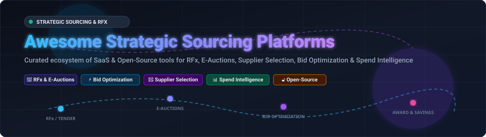

# Awesome-Strategic-Sourcing-Platform 🎯

<div align="center">



<br/>

<a href="https://github.com/ishandutta2007/Awesome-Awesome-Awesome"></a><a href="https://discord.gg/jc4xtF58Ve"></a>
<a href="https://github.com/ishandutta2007/Awesome-Strategic-Sourcing-Platform/stargazers"></a>
<a href="https://github.com/ishandutta2007/Awesome-Strategic-Sourcing-Platform/network/members"></a>
<a href="https://github.com/ishandutta2007/Awesome-Strategic-Sourcing-Platform/pulls"></a>
<a href="https://opensource.org/licenses/MIT"></a>
<a href="https://github.com/ishandutta2007"></a>

</div>

---

## 🌟 Top Strategic Sourcing Platforms & Ecosystem

> **Curated List of SaaS Products & Open-Source GitHub Projects**  
> *Focused on Strategic Sourcing, RFx (RFI/RFP/RFQ), Reverse E-Auctions, Supplier Selection, Bid Optimization, Spend Analytics & Procurement Intelligence.*  
> **Last updated: August 2026**

This repository tracks notable **SaaS/hosted platforms** and **open-source projects** for **Strategic Sourcing and E-Procurement**. These enterprise systems and developer building blocks empower procurement teams, supply-chain leaders, and developers to discover qualified vendors, issue electronic RFIs/RFPs/RFQs, execute reverse e-auctions, compare multi-tier bids, optimize supplier allocation with linear programming, compute Total Cost of Ownership (TCO), negotiate contracts, and measure realized cost savings.

---

## 📑 Table of Contents

* [📊 Market Overview & Industry Dynamics](#-market-overview--industry-dynamics)
* [🏢 SaaS / Hosted Platforms](#-saashosted-platforms)
* [🔓 Open-Source GitHub Projects](#-open-source-github-projects)
* [🏗️ Self-Hosted Sourcing Stack Blueprint](#️-self-hosted-sourcing-stack-blueprint)
* [🤝 How to Contribute](#-how-to-contribute)
* [📈 Star History](#-star-history)
* [📜 Disclaimer](#-disclaimer)

---

## 📊 Market Overview & Industry Dynamics

> 💡 **Market Size & Growth:** The global strategic sourcing and procurement software market is estimated at **$9.5B–$10.5B in 2026** and is projected to expand to **$18.0B–$20.5B by 2032–2035**, registering a strong Compound Annual Growth Rate (CAGR) of **~9.5%–11.2%**.
>
> 🧩 **Market Concentration & Structure:** The industry exhibits **moderate fragmentation**. While established mega-cap enterprise suites (such as SAP Ariba, Coupa, Workday, and Ivalua) capture significant high-volume spend in Fortune 500 enterprises, the broader market remains highly dynamic and far from "winner-take-all." Fast-growing innovators specializing in autonomous AI intake orchestration (e.g., Zip), combinatorial bid optimization (e.g., Keelvar), tail-spend automation (e.g., Fairmarkit), and mid-market on-demand e-sourcing (e.g., Market Dojo) capture substantial market share.

---

## 🏢 SaaS/Hosted Platforms

| Platform | Company Scale / Valuation / Revenue | Description & Key Sourcing Features | Pricing (Starting Tier) | Free Tier / Trial Limits |
| :--- | :--- | :--- | :--- | :--- |
| **[SAP Ariba Sourcing](https://www.sap.com/products/spend-management/ariba.html)** | **~$240B+ Market Cap**<br>*(Parent SAP SE ~$35B+ ARR; $4.3B Ariba acquisition)* | Enterprise strategic sourcing suite for RFIs/RFPs, e-auctions, supplier discovery, bid comparison, sourcing events, and collaborative procurement workflows. | Starts at ~$10,000/year (or ~$2,000/month for entry modular spend management packages) | **Free Forever** Standard Account for suppliers (order processing, digital invoicing, RFx responses; up to 4 free transacted documents/year); 14-day free trial on select planning modules. |
| **[Workday Strategic Sourcing](https://www.workday.com/)** | **~$70B+ Market Cap**<br>*(Parent Workday ~$7.3B+ ARR; $540M Scout RFP acquisition)* | Collaborative sourcing platform (formerly Scout RFP) supporting RFx event management, supplier engagement pipelines, reverse auctions, and contract intake. | Starts at ~$12,000/year (~$1,000/month for base sourcing event management) | **Free Forever** supplier portal (unlimited bid submissions for invited vendors); 14-day trial historically available via Scout RFP, currently live demo only. |
| **[Coupa Sourcing](https://www.coupa.com/products/sourcing/)** | **$8.0B Valuation**<br>*(Acquired by Thoma Bravo for $8.0B; ~$800M+ ARR)* | Enterprise strategic sourcing and business spend management platform for complex sourcing events, supplier competition, reverse auctions, and award optimization. | Starts at ~$2,500/month (~$30,000/year for baseline strategic sourcing modules) | **Free Forever** Coupa Supplier Portal (CSP) account (unlimited RFx bidding, PO tracking, and e-invoicing for invited suppliers); No buyer free trial (guided live demo only). |
| **[GEP SMART](https://www.gep.com/software/smart)** | **~$2.5B+ Valuation**<br>*(Private enterprise leader; ~$500M+ Annual Revenue)* | Unified AI-driven procurement platform combining spend analysis, strategic sourcing, supplier lifecycle management, contract management, and savings tracking. | Starts at ~$75,000/year (~$6,250/month for single-module mid-market strategic sourcing deployments) | **Free Forever** supplier network profile (unlimited responses to buyer RFPs and reverse auctions); No buyer free trial (interactive demo upon request). |
| **[Zip](https://ziphq.com/)** | **$2.2B Valuation**<br>*(Series D unicorn; ~$50M+ ARR)* | Modern intake-to-procure orchestration platform streamlining procurement intake, approval routing, vendor risk reviews, sourcing triggers, and ERP integrations. | Starts at ~$25,000/year (~$2,083/month for intake and sourcing orchestration) | **Free Forever** unlimited requester seats for general employees (procurement/admin seats require paid license); No self-serve trial (guided product tour/demo). |
| **[JAGGAER Sourcing](https://www.jaggaer.com/)** | **~$1.5B+ Valuation**<br>*(Acquired by Cinven / Vista Equity / TCV; ~$200M+ ARR)* | Comprehensive source-to-pay platform supporting RFx events, e-auctions, supplier selection, bid evaluation, category management, and Jaggaer Direct capabilities. | Starts at ~$25,000/year (~$2,083/month for core e-sourcing module) | **Free Forever** supplier portal (profile registration, document submission, and unlimited bidding on buyer events); No buyer free trial (custom sandbox demo only). |
| **[Ivalua Sourcing](https://www.ivalua.com/)** | **~$1.4B+ Valuation**<br>*(Unicorn valuation; ~$180M+ Annual Revenue)* | Enterprise source-to-pay suite covering sourcing events, supplier collaboration, multi-dimensional bid analysis, award optimization, and contract management. | Starts at ~$150,000/year (~$12,500/month for mid-market/enterprise suite deployments) | **Free Forever** supplier collaboration portal (unlimited proposal submissions to participating buyer RFx/auctions); No buyer free trial (custom demo environment only). |
| **[Corcentric (formerly Determine)](https://www.corcentric.com/)** | **~$1.2B Valuation**<br>*(Enterprise valuation; ~$200M+ Annual Revenue)* | Source-to-pay and sourcing management platform featuring RFP/auction automation, contract lifecycle management, supplier scorecards, and spend analytics. | Starts at ~$20,000/year (~$1,666/month for strategic sourcing & contract module) | **Free Forever** vendor portal (unlimited responses to client sourcing events); No buyer free trial (demo upon request). |
| **[Zycus](https://www.zycus.com/)** | **~$1.0B+ Valuation**<br>*(Cognitive S2P leader; ~$120M+ Annual Revenue)* | Cognitive procurement and source-to-pay suite offering Merlin AI-driven strategic sourcing, supplier risk management, spend analytics, and sourcing optimization. | Starts at ~$50,000/year (~$4,166/month for entry AI sourcing suite) | **Free Forever** supplier network access for invited vendors (RFx response, catalog hosting); No buyer free trial (guided demo only). |
| **[Fairmarkit](https://www.fairmarkit.com/)** | **~$450M Valuation**<br>*(Series C; Raised $80M+)* | Autonomous sourcing platform specializing in tail-spend automation, automated RFx event creation, intelligent vendor matching, and algorithmic bid comparison. | Starts at ~$50/user/month (or ~$25,000/year platform base tier for autonomous sourcing) | **Free Forever** supplier quotation portal (zero-fee quote submissions for invited tail-spend vendors); No free trial (guided proof-of-value pilot upon request). |
| **[Keelvar](https://www.keelvar.com/)** | **~$300M+ Valuation**<br>*(Series B; Raised $43M+)* | Autonomous sourcing bots and combinatorial optimization engine engineered for complex multi-million dollar freight, packaging, and direct material sourcing events. | Starts at ~$30,000/year (~$2,500/month for Sourcing Optimizer tier) | **Free Forever** bidder access for invited vendors (scenario submission and bid upload); No self-serve trial (30-day proof-of-concept / sandbox available on request). |
| **[Arkestro](https://arkestro.com/)** | **~$250M+ Valuation**<br>*(Series B; Raised $40M+)* | Predictive procurement orchestration platform using machine learning to suggest optimal pricing, terms, and supplier selections dynamically in RFx events. | Starts at ~$30,000/year (~$2,500/month for predictive procurement orchestrator) | **Free Forever** supplier quote submission portal; 30-day proof-of-value pilot program (limited to agreed transaction/spend scope). |
| **[Proactis](https://www.proactis.com/)** | **~$90M Valuation**<br>*(Acquired by Pollen Street / Cafe Bidco; ~$75M+ Revenue)* | Source-to-pay and procurement solution with modular e-sourcing, supplier compliance, tender management, contract management, and spend intelligence. | Starts at ~$1,200/month (~$14,400/year for modular e-sourcing package) | **Free Forever** supplier portal for responding to buyer tenders and PO acknowledgment; No buyer free trial (guided demo only). |
| **[SynerTrade](https://www.synertrade.com/)** | **~$60M+ Annual Revenue**<br>*(Parent Econocom Group €2.8B+ Revenue)* | Digital procurement and source-to-pay platform covering strategic sourcing, supplier lifecycle, e-auctions, spend analysis, and category contract governance. | Starts at ~$30,000/year (~$2,500/month for Digital Procurement strategic sourcing module) | **Free Forever** supplier onboarding portal (RFx participation and qualification); No buyer free trial (demo on request). |
| **[Scanmarket (Unit4)](https://www.scanmarket.com/)** | **~$50M+ Valuation**<br>*(Acquired by Unit4 / TA Associates; Unit4 ARR $400M+)* | Strategic sourcing suite supporting RFx, reverse auctions, supplier management, spend analytics, and procurement project management. | Starts at ~$1,500/month (~$18,000/year for core e-sourcing module) | **Free Forever** supplier portal (unlimited participation in e-auctions and RFPs); No self-serve trial (custom guided trial/demo upon request). |
| **[Bonfire (Euna Procurement)](https://bonfirehub.com/)** | **~$40M+ ARR**<br>*(Part of Euna Solutions / GTY Technology ~$100M+ ARR)* | E-procurement and strategic sourcing platform tailored for public-sector agencies, education, healthcare, and regulated procurement organizations. | Starts at ~$9,000/year (~$750/month for foundational public-sector sourcing tier) | **Free Forever** vendor account (search public bids, download documents, and submit bids without fees); No buyer free trial (custom public agency demo only). |
| **[OroCommerce](https://oroinc.com/)** | **~$30M+ Valuation**<br>*(Open-source origin; ~$15M+ ARR)* | Open-source-origin B2B commerce and procurement platform supporting vendor management, custom RFP workflows, buyer punchout, and purchasing logic. | Starts at $45,000/year (~$3,750/month for OroCloud Enterprise edition) | **Free Forever** Community Edition (open-source, self-hosted with unlimited users); 30-day free trial for OroCloud hosted environment. |
| **[Market Dojo](https://www.marketdojo.com/)** | **~$10M+ ARR**<br>*(Acquired by Esker; standalone modular ARR)* | On-demand e-sourcing platform focused on RFx events, reverse auctions, supplier bidding, procurement competitions, and savings tracking. | Starts at £500/month (or £2,500/event on-demand; annual plans starting at ~£5,000/year) | **Free Forever** "Sandpit" (sandbox test environment limited to 3 users and non-live simulation events); Free Forever supplier portal (unlimited responses to buyer invitations). |

---

## 🔓 Open-Source GitHub Projects

*Sorted by GitHub Star Count (Descending)*

1. **[Odoo Purchase & Sourcing](https://github.com/odoo/odoo)** [](https://github.com/odoo/odoo/stargazers)  
   Enterprise open-source ERP with full procurement modules including automated RFQs, purchase tenders, supplier pricelists, multi-currency vendor evaluation, and approval hierarchies.

2. **[ERPNext Procurement](https://github.com/frappe/erpnext)** [](https://github.com/frappe/erpnext/stargazers)  
   Comprehensive 100% open-source ERP featuring supplier scorecards, RFQ distribution, supplier quotation comparison matrices, pricing rules, purchasing analytics, and PO workflows.

3. **[Dolibarr ERP/CRM](https://github.com/Dolibarr/dolibarr)** [](https://github.com/Dolibarr/dolibarr/stargazers)  
   Modular open-source ERP with supplier lifecycle tracking, commercial proposals, supplier price comparison, purchase orders, and supplier invoice auditing.

4. **[Apache OFBiz](https://github.com/apache/ofbiz-framework)** [](https://github.com/apache/ofbiz-framework/stargazers)  
   Apache top-level enterprise automation framework providing advanced supply-chain mechanics, procurement agreements, requirement matching, and multi-facility supplier ordering.

5. **[Tryton ERP](https://github.com/tryton/tryton)** [](https://github.com/tryton/tryton/stargazers)  
   Highly modular Python-based business framework providing a clean transactional core for custom sourcing pipelines, supplier catalogs, and purchasing logic.

6. **[Q-Flow RFP & Questionnaire RAG Agent](https://github.com/degerahmet/q-flow)** [](https://github.com/degerahmet/q-flow/stargazers)  
   AI-powered RAG agent designed to parse, extract, and automate responses to vendor evaluation questionnaires, complex RFx requests, and compliance documents.

7. **[OpenProcurement API & Engine](https://github.com/openprocurement/openprocurement.api)** [](https://github.com/openprocurement/openprocurement.api/stargazers)  
   State-of-the-art open-source procurement and e-tendering toolkit featuring a business process management (BPM) engine, RESTful procurement APIs, reverse auction modules, and multi-stage bidding.

8. **[Awesome Supply Chain & Supplier Selection](https://github.com/kishorkukreja/awesome-supply-chain)** [](https://github.com/kishorkukreja/awesome-supply-chain/stargazers)  
   Curated algorithms and mathematical models for supplier selection, total cost of ownership (TCO) estimation, and multi-criteria decision making using PuLP, Pyomo, and CVXPY.

9. **[Procurement Management & Optimization](https://github.com/samirsaci/procurement-management)** [](https://github.com/samirsaci/procurement-management/stargazers)  
   Data science and mathematical optimization tools for procurement workflows, cost analysis, supplier volume discounts, and inventory replenishment modeling.

10. **[Procurement Optimization Suite](https://github.com/virbahu/procurement-optimization)** [](https://github.com/virbahu/procurement-optimization/stargazers)  
    Open-source sourcing optimization algorithms implementing multi-attribute supplier allocation, scenario modeling, total cost curves, and carbon-emission constraints.

11. **[OpenSourcingOS](https://github.com/gruvyo/opensourcingos)** [](https://github.com/gruvyo/opensourcingos/stargazers)  
    Strategic sourcing savings tracker for recording project baselines, supplier negotiation rounds, cost avoidance, and realized savings milestone schedules.

12. **[Smart Procurement System](https://github.com/MhdHlal/smart-procurement-system)** [](https://github.com/MhdHlal/smart-procurement-system/stargazers)  
    Automated procurement application focused on BOM-driven RFQ generation, supplier-to-material matching, and side-by-side bid comparison matrices.

13. **[Tryton Purchase Module](https://github.com/tryton/purchase)** [](https://github.com/tryton/purchase/stargazers)  
    Dedicated purchasing extension for Tryton supporting supplier price catalogs, lead times, requisitions, and purchase orders.

14. **[Procurement AI Assistant Skills](https://github.com/arunbalajiraju-proc/procurement-ai-assistant)** [](https://github.com/arunbalajiraju-proc/procurement-ai-assistant/stargazers)  
    Open-source library of reusable AI skills and prompts for category management, supplier discovery, contract term extraction, and spend diagnostics.

15. **[B2B Buyer & Vendor Evaluation Skill](https://github.com/salespeak-ai/buyer-eval-skill)** [](https://github.com/salespeak-ai/buyer-eval-skill/stargazers)  
    Claude Code and LLM skill for automated B2B software vendor evaluation, domain-expert question generation, and scorecards.

16. **[Reverse Auction Simulator](https://github.com/virbahu/reverse-auction-simulator)** [](https://github.com/virbahu/reverse-auction-simulator/stargazers)  
    Simulation and modeling engine for procurement reverse auctions, English/Dutch auction dynamics, and supplier bidding strategy evaluation.

17. **[Freight Auction & Winner Optimizer](https://github.com/virbahu/freight-auction-optimizer)** [](https://github.com/virbahu/freight-auction-optimizer/stargazers)  
    Combinatorial auction solver for the winner determination problem (WDP), lane-level bidding, and supplier capacity constraint modeling.

18. **[Procurement Skills Library](https://github.com/sourcesquid-ops/procurement-skills)** [](https://github.com/sourcesquid-ops/procurement-skills/stargazers)  
    AI agent skills framework covering RFQ generation, proposal extraction, vendor scorecards, and spend categorization.

19. **[PlushSource MCP](https://github.com/quickman924/plushsource-mcp)** [](https://github.com/quickman924/plushsource-mcp/stargazers)  
    Open-source MCP server for supplier discovery in custom plush manufacturing: lets AI assistants search and compare the 55 factories listed on [PlushSource](https://plushsource.com) by MOQ, lead time, OEM/ODM and claimed certifications, with facts compiled from each factory's own website.

---

## 🏗️ Self-Hosted Sourcing Stack Blueprint

```
┌──────────────────────────────────────────────────────────────────────────────────────────────────┐
│                             MODULAR STRATEGIC SOURCING PIPELINE                                  │
└──────────────────────────────────────────────────────────────────────────────────────────────────┘
   ┌───────────────┐     ┌───────────────┐     ┌───────────────┐     ┌───────────────┐
   │ 1. SUPPLIER   │ ──> │ 2. RFx /      │ ──> │ 3. BID        │ ──> │ 4. SCENARIO   │
   │    DISCOVERY  │     │    AUCTIONS   │     │    EVALUATION │     │    MODELING   │
   └───────────────┘     └───────────────┘     └───────────────┘     └───────────────┘
          │                     │                     │                     │
          ▼                     ▼                     ▼                     ▼
   [ERPNext / Odoo]     [OpenProcurement]     [SmartProcure]       [PuLP / Pyomo / OR-Tools]
          │                     │                     │                     │
          ▼                     ▼                     ▼                     ▼
   ┌───────────────┐     ┌───────────────┐     ┌───────────────┐     ┌───────────────┐
   │ 5. AWARD      │ ──> │ 6. CONTRACT   │ ──> │ 7. PO & S2P   │ ──> │ 8. SAVINGS    │
   │    OPTIMIZER  │     │    MANAGEMENT │     │    EXECUTION  │     │    TRACKING   │
   └───────────────┘     └───────────────┘     └───────────────┘     └───────────────┘
          │                     │                     │                     │
          ▼                     ▼                     ▼                     ▼
   [WDP Solvers]         [Dolibarr / OFBiz]   [ERP Core Modules]    [OpenSourcingOS]
```

### 🧰 Key Building Blocks for Self-Hosting

* **Tendering & Auctions:** **OpenProcurement** (BPM engine, REST API, multi-round reverse auctions).
* **Vendor & Purchase Master Data:** **ERPNext** or **Odoo** (catalogs, purchase orders, vendor master, approval chains).
* **Mathematical Optimization & Award Modeling:** **PuLP**, **Google OR-Tools**, **Pyomo**, or **SciPy** (combinatorial multi-vendor allocations, quantity breaks, capacity and ESG constraints).
* **AI & Document Intelligence:** **Q-Flow** and **Procurement AI Assistant** (automated RFP parsing, requirement extraction, proposal summarization).
* **Savings Tracking:** **OpenSourcingOS** (baseline price tracking, contracted savings schedules, cost avoidance).

---

## 🤝 How to Contribute

1. 🍴 Fork the repository.
2. ✏️ Add or update entries in `README.md` (ensure formatting matches the existing tables and star badges).
3. 🔎 Keep pricing, valuation, and free tier limits factual and linked to primary or authoritative industry sources.
4. 🚀 Submit a Pull Request with a brief summary of your updates.

---

## 📈 Star History

[](https://star-history.dera.page/#ishandutta2007/Awesome-Strategic-Sourcing-Platform&type=date&legend=top-left)

---

## 📜 Disclaimer

* This is a **community-curated** reference list — not an endorsement of any commercial platform or open-source repository.
* Enterprise sourcing deployments should always be evaluated against organizational compliance, data governance, security, integration capabilities, and commercial terms.
* Open-source software licenses vary by project; verify licensing requirements before deploying in enterprise production.

---

<div align="center">
  <sub>Made with ❤️ for procurement teams, strategic sourcing professionals, category managers, supply-chain leaders, and enterprise developers.</sub>
</div>
